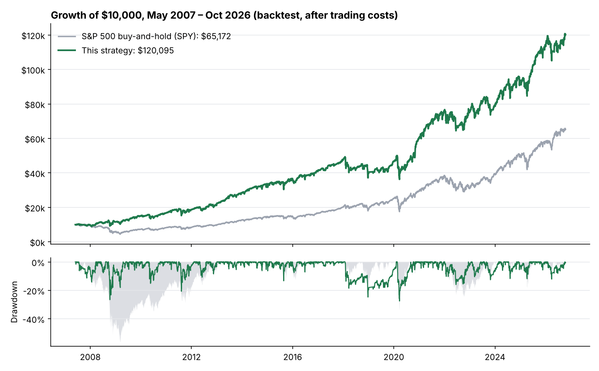

# Automated S&P 500 Trading System

**Gavin Rossi · Finance, Rutgers Business School**

A rules-based trading system that trades the S&P 500 automatically every market day and reports to my phone before the open and after the close. I chose the strategy by researching and backtesting 15+ candidate strategies on about 20 years of daily market data, keeping only the ones that held up in both halves of the test period. It currently runs on a paper (simulated-money) brokerage account.



## Results (backtest, May 2007 – Oct 2026, after trading costs)

| | This strategy | S&P 500 buy-and-hold (SPY) |
| --- | --- | --- |
| Annual return | **13.7%** | 10.2% |
| Worst peak-to-trough drop | **−27.5%** | −56.5% |
| Worst calendar year | **−16.3%** (2018) | −38.3% (2008) |
| Return ÷ volatility | **0.84** | 0.59 |
| $10,000 became | **$120,100** | $65,200 |

Backtest results are hypothetical and don't guarantee future performance. Live paper trading began in November 2026.

## The strategy

The account is split into two halves that work in opposite market conditions.

| Half | Rule | Trades |
| --- | --- | --- |
| **Trend (50%)** | At each month-end, hold SPY if it closed above its 200-day moving average; otherwise move to T-bills (BIL). Sits out long bear markets. | ~1–2 per year |
| **Mean reversion (50%)** | IBS (Internal Bar Strength) = where SPY closed within the day's high-low range. After a weak close (IBS < 0.2), buy SSO, a 2x S&P 500 fund. Sell after a strong close (IBS > 0.8). Profits from short-term overreactions. | ~28 round trips per year |

The halves complement each other. Mean reversion does best in volatile years (2008, 2020, 2022) and the trend filter does best in steady bull markets. Together they cut the worst drop roughly in half compared with the index.

## Research process

Every candidate had to beat buy-and-hold on a risk-adjusted basis in **both** 2007–2015 and 2016–2026, after trading costs, to survive.

1. **Started with published strategies.** Dual momentum (Antonacci) plus an RSI(2) sleeve was the first pick. **It failed the backtest**, trailing the S&P 500 by about 3.7 points a year: its switch into bonds in June 2022 hit just as bonds crashed, and it was fragile to its lookback setting.
2. **Tested 13 daily and calendar strategies.** These included overnight holding, intraday, turn-of-the-month, moving-average crossovers, Bollinger bands, RSI(2), volatility targeting, and IBS. Every strategy that trades daily lost money once costs were included. Only the 200-day filter and IBS passed.
3. **Stress-tested IBS.** Re-ran it with next-day-open execution instead of the close, across several entry/exit thresholds, and against higher trading costs.
4. **Tested leverage.** Ran the IBS half on a synthetic 2x fund, then validated with real SSO prices. Rejected 3x leverage (a 65% worst drop) and a "leverage only in uptrends" rule, which performed worse.

Scripts are in [`backtest/`](backtest/). Price data (Stooq) is in [`data/`](data/).

## How it works

```
Scheduled runs (weekdays)
   ├─ 8:40am ET  premarket:  pull SPY prices → compute signals → place market-on-open orders → message
   └─ 4:25pm ET  recap:      read fills + account P&L → preview tomorrow's signals → message
        │
        ├─ Alpaca API: market data + paper brokerage
        └─ Telegram / Twilio: notifications
```

- **Stateless:** each run recomputes the correct position from price history, so a missed day corrects itself.
- **Accurate signals:** IBS is rebuilt from regular-session (9:30–4:00) bars, because daily bars can include after-hours trades.
- **Verified:** the live signal code matched the backtest's positions on all 1,201 trading days checked (2022–2026).
- **Safe to re-run:** open orders are cancelled before new ones are placed, and the bot only touches the symbols it manages.

## Tools

Python (pandas, NumPy, matplotlib) · Alpaca brokerage API · GitHub Actions · Telegram / Twilio

To run it yourself, see the [setup guide](SETUP.md).
